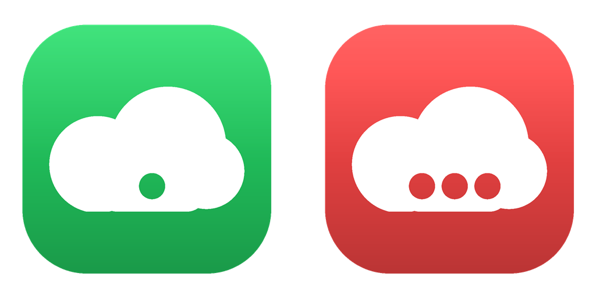
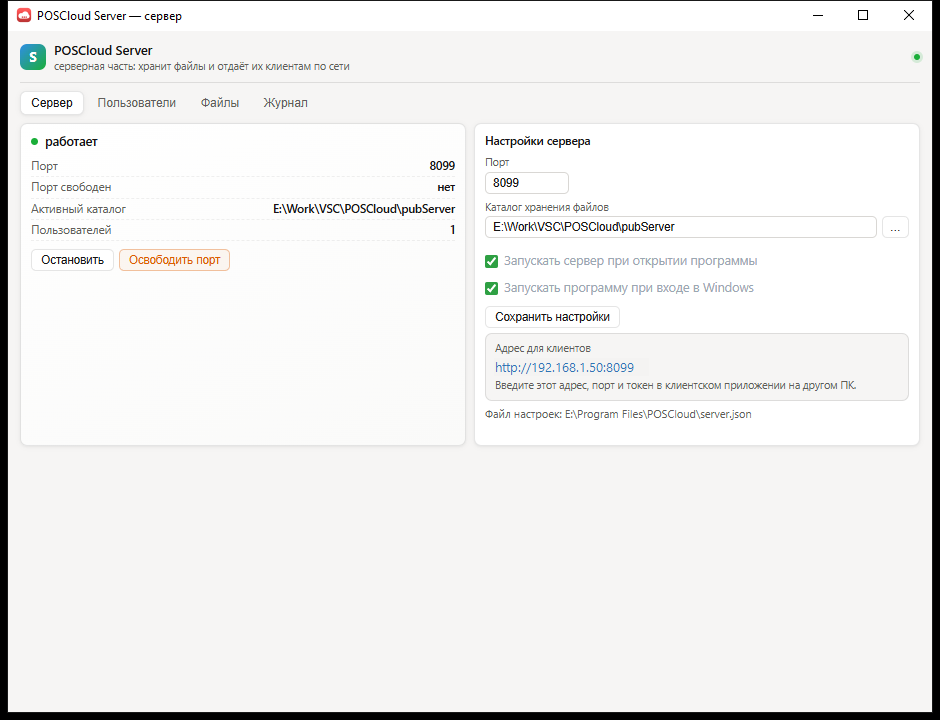
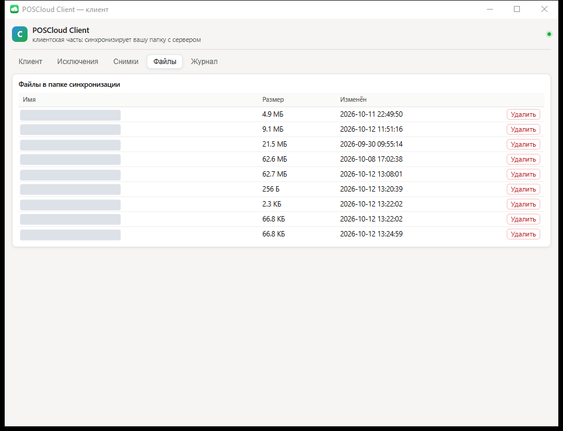

<p align="center"></p>

<p align="center">
  <b>Синхронизация папок между своими устройствами.</b><br>
  Сервер хранит файлы, клиент следит за выбранной папкой — файлы сами доезжают до всех устройств.
</p>

Два небольших приложения для Windows: **POSCloud Server** (хранит файлы и отдаёт их по HTTP)
и **POSCloud Client** (следит за папкой и синхронизирует её с сервером). Оба живут в трее:
закрытие окна не завершает программу. Написаны на Go (Wails + WebView2), всё крутится
на своих устройствах — внешние сервисы не нужны.

## Как это выглядит

**Сервер** — статус, адрес для клиентов, настройки и журнал:



**Клиент** — папка синхронизации, список файлов, снимки экрана и журнал:



## Возможности

**Клиент**

- **двусторонняя синхронизация**: опрос по интервалу, слежение за файлами (fsnotify) и подписка
  на изменения сервера (SSE) — файлы уходят и приходят без ожидания следующего цикла;
- **блочная передача**: файлы режутся на блоки по содержимому (SHA-256), передаются только
  недостающие блоки — повторяющиеся данные не пересылаются;
- **версии и удаления**: сервер ведёт манифест с версиями и «надгробиями» (tombstones), поэтому
  удаления и переименования доезжают до других устройств, а не возвращают файлы обратно;
- **исключения** (`.poscloudignore`): готовые наборы галочками, выбор из папки, импорт и экспорт,
  предпросмотр («попадёт N из M файлов»);
- **режимы папок**: для любой подпапки можно выбрать режим — в обе стороны, только отправлять
  на сервер, только получать с сервера или не синхронизировать вовсе (правила у каждого
  устройства свои);
- **снимки экрана**: весь экран, активное окно и произвольная область; настраиваемые горячие
  клавиши; редактор со стрелкой, размытием и текстом; снимок сразу попадает в буфер обмена;
- **конфликты не теряются**: при расхождении версий создаётся конфликтная копия файла;
- **автозапуск в двух смыслах**: начинать синхронизацию при открытии программы и запускать
  программу при входе в Windows — две отдельные галочки;
- контекстное меню в трее: состояние, пауза, «открыть папку», «синхронизировать сейчас», журнал.

**Сервер**

- **HTTP-хранилище с токенами устройств**: в реестре хранятся только хэши, открытый токен
  показывается один раз;
- **изоляция по пользователям**: у каждого своя папка, свой манифест и своё блочное хранилище;
- управление пользователями и токенами прямо в окне; журнал запросов и список файлов;
- **надёжный реестр**: атомарная запись, резервная копия и автовосстановление — внезапное
  выключение ПК не приводит к потере пользователей;
- **освобождение порта**: если порт занят чужой программой, сервер покажет её имя и PID
  и завершит только после подтверждения; собственный процесс не завершается никогда;
- подчищает пустые каталоги после удаления файлов;
- автозапуск сервера при открытии программы, защита от двойного запуска, работа в трее.

## Начало работы

1. **Установите приложения.** Соберите установщик (см. раздел «Установщик») и отметьте нужные
   компоненты — «Сервер» и/или «Клиент».
2. **На серверном ПК** запустите POSCloud Server и нажмите «Запустить» — в окне появится
   адрес для клиентов (`http://192.168.х.х:<порт>`).
3. Создайте пользователя и устройство, скопируйте выданный **токен** — он показывается один раз.
4. **На клиентском ПК** запустите POSCloud Client, введите адрес и порт сервера, вставьте токен,
   выберите папку синхронизации → «Проверить связь» → «Запустить».

Если компьютеры в разных сетях — нужен доступный маршрут между ними: проброс порта, VPN
или публичный адрес.

## Установщик

Единый установщик для Windows (Inno Setup) с выбором компонентов:

- отмечаете **«Сервер»**, **«Клиент»** или оба сразу;
- ярлыки в «Пуск» и, по желанию, на рабочем столе;
- проверяет наличие Microsoft Edge WebView2 Runtime (в Windows 11 встроен);
- удаление не трогает данные приложения (`users.json`, `server.json`, журналы).

Сборка установщика (нужен [Inno Setup 6](https://jrsoftware.org/isinfo.php)):

```powershell
cd installer
.\build.ps1                 # собрать приложения и установщик
.\build.ps1 -SkipApps       # только установщик (exe уже собраны)
```

Результат — `installer\out\POSCloud-Setup-<версия>.exe`. Подробности — в [installer/README.md](installer/README.md).

## Сборка из исходников

Нужны Go 1.25+ и Wails CLI v2.

```powershell
cd poscloud-client
wails build -s -skipbindings -webview2 browser

cd ..\poscloud-server
wails build -s -skipbindings -webview2 browser
```

Готовые файлы появляются в `build\bin\`. Иконку и оконные ресурсы подкладывает только
`wails build`: собранный вручную через `go build` exe останется без иконки.

## Проверка

```powershell
cd poscloud-client; go test ./...
cd ..\poscloud-server; go test ./...
```

## Структура

| Путь | Что это |
|---|---|
| `poscloud-client/` | приложение-клиент: синхронизация, снимки экрана, трей, горячие клавиши |
| `poscloud-server/` | приложение-сервер: хранилище, пользователи и токены, журнал |
| `installer/` | установщик: `poscloud-setup.iss` и сборка `build.ps1` |
| `docs/images/` | картинки для этого README |
| `poscloud-*/build/bin/` | результат сборки |

## Где что лежит

| Что | Где |
|---|---|
| Настройки клиента и сервера | `client.json` / `server.json` рядом с приложением |
| Журналы | `client.log` / `server.log` там же |
| Реестр пользователей и токенов | `users.json` рядом с сервером (+ резервная копия `.bak`) |
| Файлы пользователей | каталог хранения сервера: `<каталог>\<пользователь>\`, манифест `.manifest.json`, блоки `.blocks\` |
| Снимки экрана клиента | подпапка «Снимки экрана» в папке синхронизации (или «Изображения\POSCloud», если отправка выключена) |

## Безопасность

- токены устройств хранятся только хэшами (SHA-256), неавторизованные запросы отклоняются (кроме `/health`);
- имена файлов проверяются на выход за пределы папки пользователя (защита от `..`), служебные
  каталоги (`.blocks`, `.manifest.json`) не синхронизируются;
- транспорт — обычный HTTP: для интернета используйте VPN или обратный прокси с TLS.

<details>
<summary><b>HTTP API для разработчиков</b></summary>

| Метод | Путь | Назначение |
|---|---|---|
| GET | `/health` | проверка доступности (единственный путь без токена) |
| GET | `/whoami` | какой пользователь и устройство обратились |
| GET | `/list` | список файлов пользователя |
| GET | `/manifest`, `/changes?since=` | манифест и изменения с указанной версии |
| GET | `/blocks`, `/block` | список блоков файла и получение блока |
| PUT | `/block` | выгрузка блока |
| POST | `/upload`, `/commit` | загрузка файла целиком и фиксация версии |
| GET | `/download`, `/blocks-all` | скачивание файла и всех его блоков |
| DELETE | `/delete` | удаление файла (надгробие) |
| GET | `/events` | подписка на изменения пользователя (SSE) |

Авторизация — заголовок `Authorization: Bearer <токен>`.
</details>

Подробности по каждому приложению — в его README:
[клиент](poscloud-client/README.md) · [сервер](poscloud-server/README.md) · [установщик](installer/README.md).
